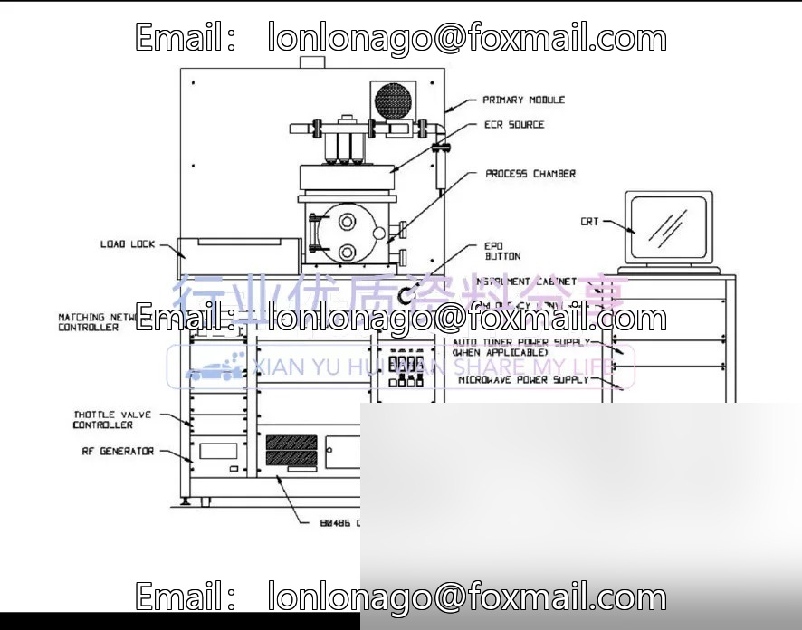
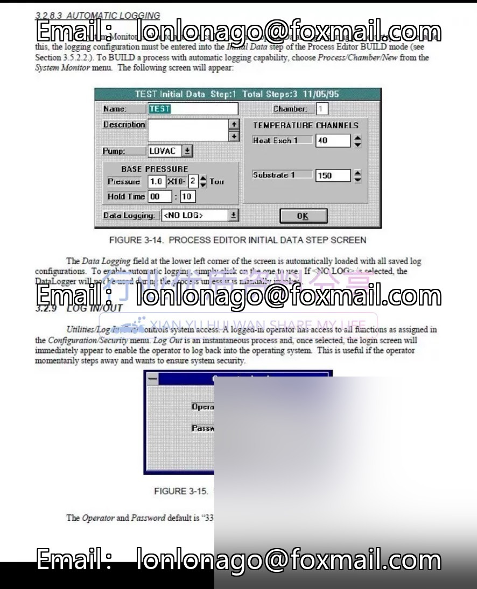
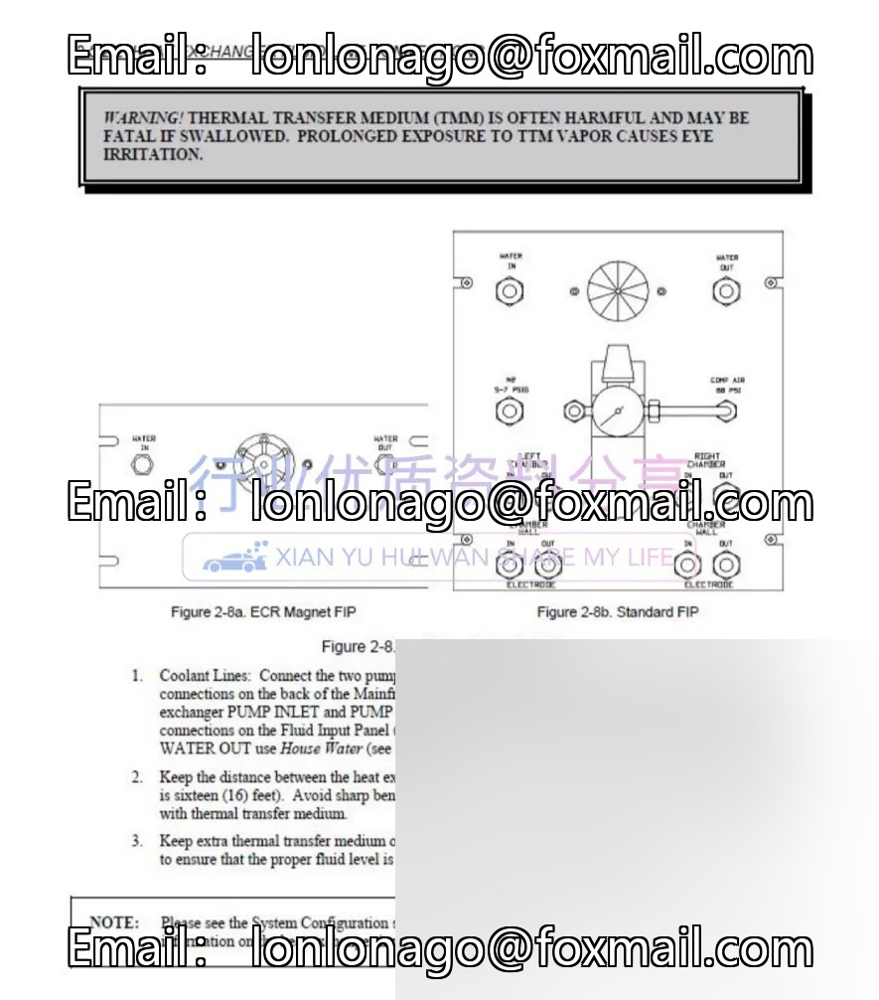
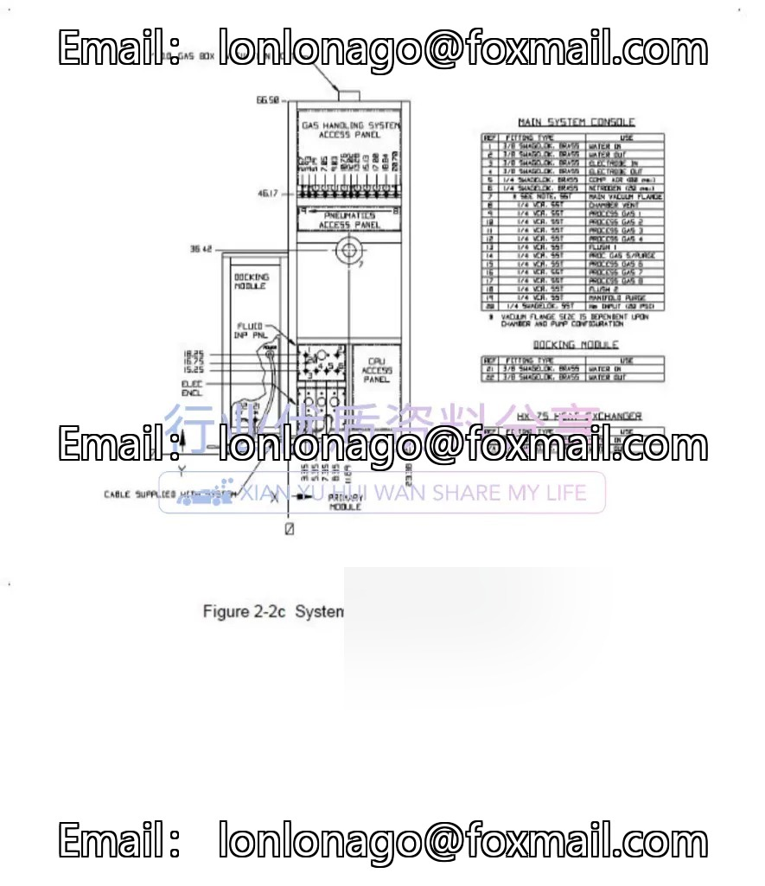
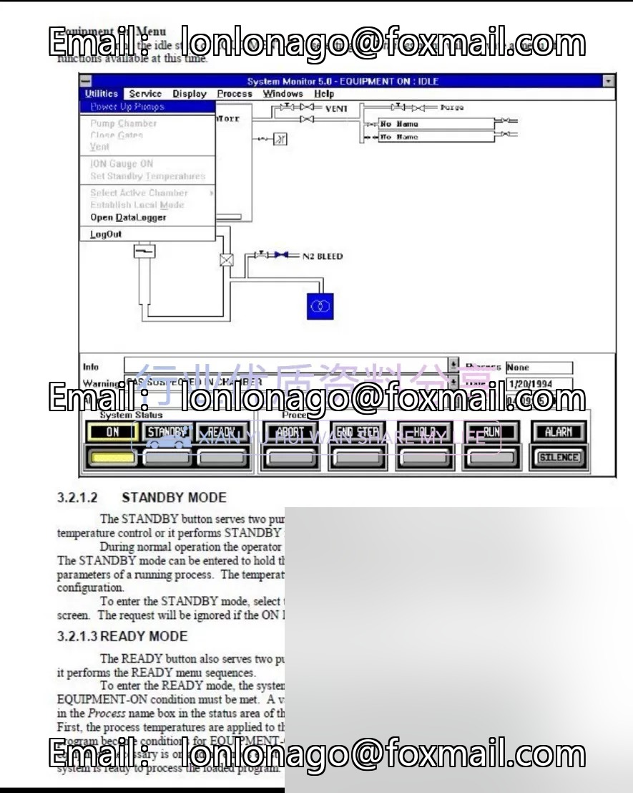
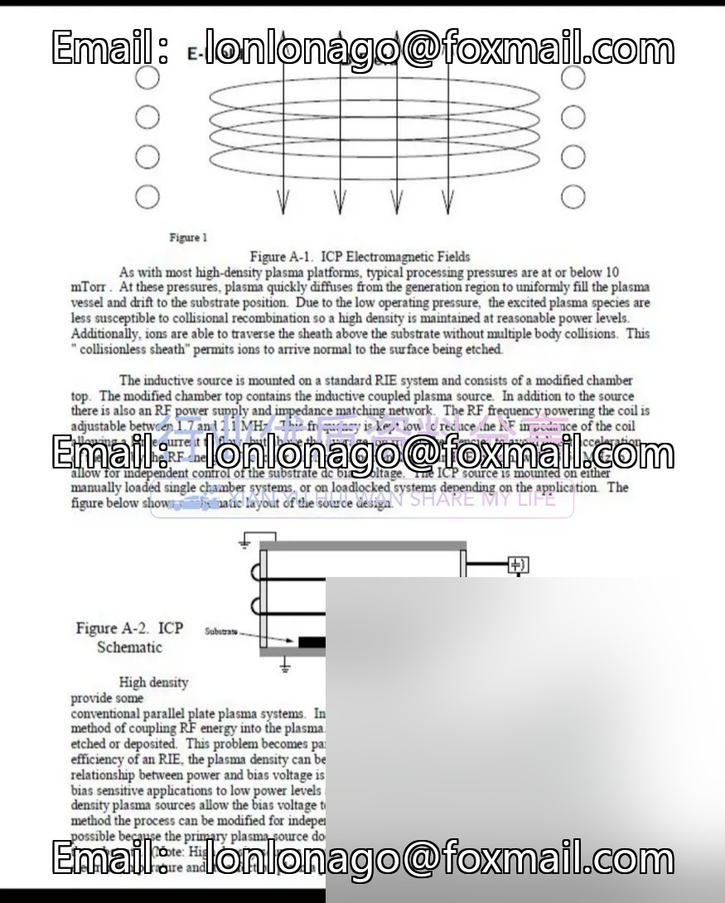

# American PlasmaTherm etching system 700/770/790 users

## Body

The US PlasmaTherm etching system 700/770/790 user manual, comprising over 200 pages of reference value, including structural descriptions, operation, and maintenance methods.

Capture and send the electronic original directly! The following images include screenshots of the file portion. Please confirm before placing the order! Due to the replicable nature of electronic documentation Therefore, are allowed after purchase! Thanks for understanding!

The American PlasmaTherm etching system includes user manuals for 700, 770 and 790; the materials span more than 200 pages and cover structural descriptions, operating and maintenance methods.

<!-- AI_ENRICHED -->

## Images

## Payment

Here is a pay link on Stripe ( https://buy.stripe.com/3cs8yP7sY87d0vu9AB ). Please contact me lonlonago@foxmail.com after funding $89, and I will send you a complete data files , thank you!

